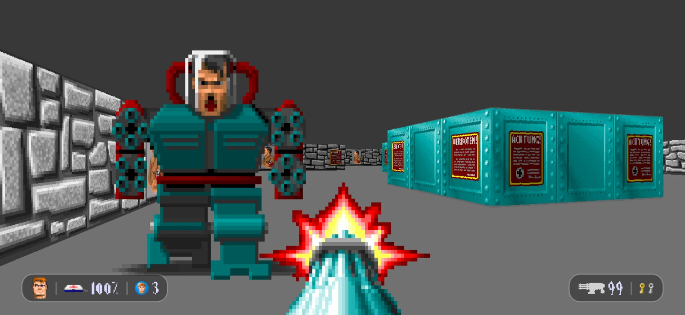
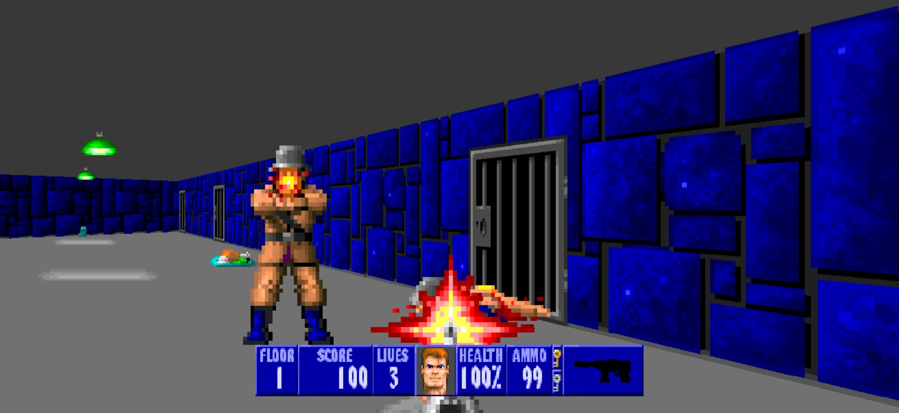
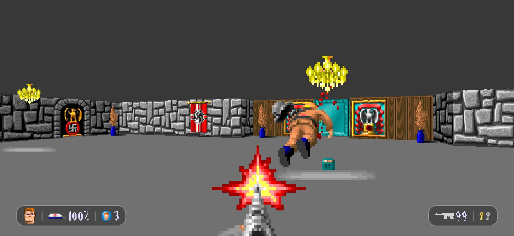
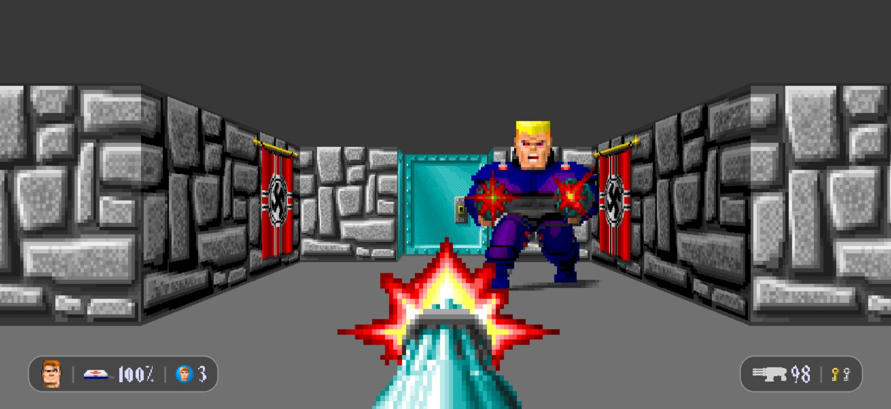
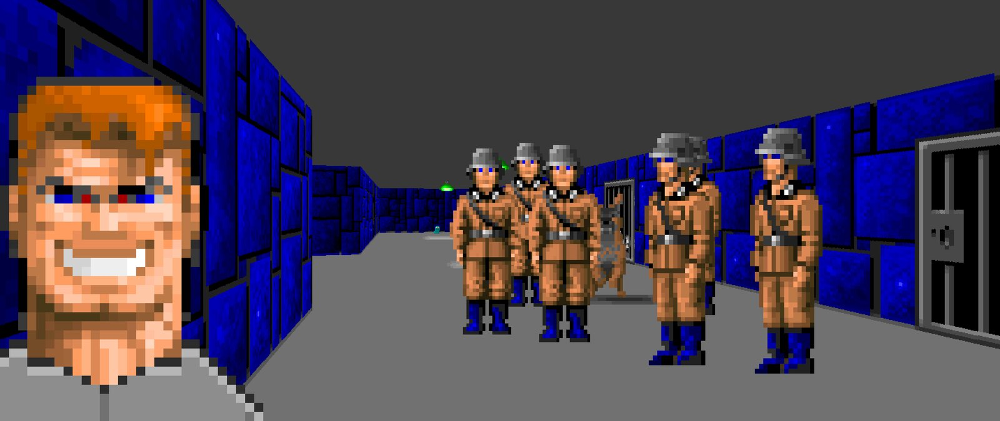
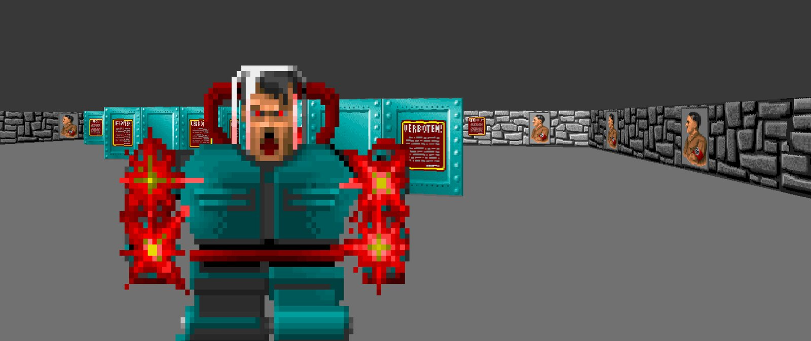
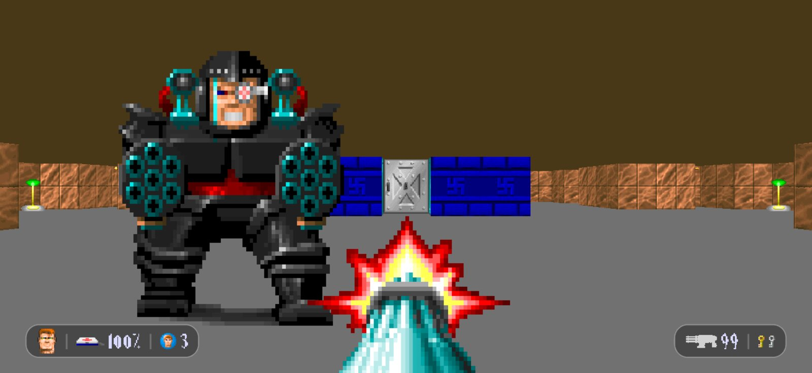
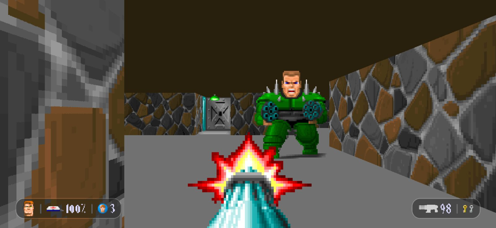

# Wolfenstein 3D and Spear of Destiny for iPhone and iPad (ECWolf)

Play **Wolfenstein 3D** (1992), **Spear of Destiny** and its two mission packs on iPhone and iPad, with touch controls. It's an unofficial port of [ECWolf](https://maniacsvault.net/ecwolf/), the Wolfenstein 3D source port. The app is called **Wolf3D**.



**You need your own copy of the game. Game files are not included.** Buy Wolfenstein 3D on [GOG](https://www.gog.com/game/wolfenstein_3d) (it comes with Spear of Destiny) or [Steam](https://store.steampowered.com/app/2270/), and Spear of Destiny on [Steam](https://store.steampowered.com/app/9000/). Then copy the game's files to your iPhone or iPad.

## Install

You need an iPhone or iPad with iOS 15 or newer. The app isn't on the App Store, so you install it yourself ("sideloading"). Pick one way:

- **SideStore or AltStore (easiest).** On your iPhone, tap **[Add to SideStore](https://sithewok13-dev.github.io/wolf3d/#add-sidestore)** or **[Add to AltStore](https://sithewok13-dev.github.io/wolf3d/#add-altstore)**, then install Wolf3D from there. Updates come the same way.
- **Feather, Sideloadly or another signing tool.** Download `Wolf3D-ios.ipa` from the [releases page](https://github.com/sithewok13-dev/ECWolf/releases) and sign it with your tool.
- **The source by hand.** In SideStore, AltStore or Feather, go to *Sources*, tap **+**, and paste this address:

  ```
  https://raw.githubusercontent.com/sithewok13-dev/ECWolf/ios/packaging/ios/altstore-source.json
  ```

Then open Wolf3D once and copy your game files into Files > On My iPhone > Wolf3D. GOG's folders work just as they are. [Step by step](https://github.com/sithewok13-dev/ECWolf/blob/ios/docs/ios/README.md#your-game-files)

AltStore here means AltStore Classic; AltStore PAL can't install it.

## Cool features

- **Widescreen at a steady 60 frames a second**, in crisp, sharp pixels.
- **Touch controls made for the game.** The move stick appears wherever your left thumb lands; slide up onto the little ^^ to run. Drag anywhere else to turn. FIRE, USE, MAP (the automap) and NEXT WPN are where your thumbs are.
- **A weapon wheel.** Slide NEXT WPN and pick knife, pistol, machine gun or chain gun from a wheel; the game waits while it's open.
- **Quick save and quick load** with a short hold on SAVE or LOAD.
- **Six HUD looks.** A modern one with BJ's face, health, lives, ammo and keys in two small pills, or the original status bar (whole, or split to the corners), in three sizes, with an opacity slider.
- **A camera.** Take photos of the action, bursts, and selfies: BJ grins in the corner while the guards and dogs around you pose for the group shot. **Action Freeze** stops time so you can fly the camera around the moment. Pictures go to your Photos.
- **The sithewok cheat.** Type it, or switch it on from the menu: a golden Ark of the Covenant button opens, and you get god mode, every weapon, every key and full ammo. Hold USE to walk through walls (noclip).
- **Jump to any level** from a list, in Wolfenstein 3D or Spear of Destiny.
- **All your games in one app.** Have both games' files? Switch between them from the menu.

## Thanks

This port stands on the work of many people. Thank you!

- **Braden "Blzut3" Obrzut** and the ECWolf contributors, for [ECWolf](https://maniacsvault.net/ecwolf/) ([source](https://github.com/ECWolfEngine/ECWolf)): years of careful work that keep Wolfenstein 3D playing well on today's machines, with widescreen, modern controls and a great automap.
- **Moritz "Ripper" Kroll**, for Wolf4SDL, the SDL port of the original code that ECWolf grew from.
- **id Software** (John Carmack, John Romero, Adrian Carmack, Tom Hall and the team), for making Wolfenstein 3D and Spear of Destiny, and for releasing the source code in 1995.
- **Randy Heit, Christoph Oelckers and Teemu Piippo**, whose ZDoom code ECWolf builds on.
- **The SDL team** (Sam Lantinga and contributors), for SDL, SDL_mixer and SDL_net, and the **DOSBox** and **MAME** teams, for the OPL sound emulators that play the game's music.

## Sorry about the bugs

This is an unofficial beta, made by a fan, so expect bugs. Sorry about them! Back up your saves (Files > On My iPhone > Wolf3D > ECWolf) before you update or reinstall.

**No multiplayer, sorry.** Wolfenstein 3D is a single-player game. ECWolf has early multiplayer test code, but it can only be started from a computer's command line, so this app has none.

Found a bug? Please [report it here](https://github.com/sithewok13-dev/ECWolf/issues), not to upstream ECWolf.

## Screenshots

<p>







</p>

*All pictures come from the app's own game code running on a computer, so they show the HUD but not the touch buttons. The selfie and the Action Freeze picture were made by the app's camera. Some enemies were moved into place for the pictures.*

[Setup guide](https://github.com/sithewok13-dev/ECWolf/blob/ios/docs/ios/README.md): installing, copying your game files, and every control.

Not affiliated with or endorsed by id Software, ZeniMax, Bethesda or Microsoft, and not an official ECWolf release.

---

*The rest of this page is upstream ECWolf's README, by Braden "Blzut3" Obrzut and the ECWolf contributors, from [ECWolfEngine/ECWolf](https://github.com/ECWolfEngine/ECWolf). Its links point to upstream; for the iOS port, see above.*

ECWolf
======

ECWolf is a port of the Wolfenstein 3D engine based of Wolf4SDL. It combines the original Wolfenstein 3D engine with the user experience of ZDoom to create the most user and mod author friendly Wolf3D source port.

Like ZDoom, ECWolf aims to support all games which use the Wolfenstein 3D engine including Blake Stone (coming in ECWolf 3.0), Corridor 7, Operation Body Count, Rise of the Triad, and Super 3D Noah's Ark.  ECWolf will also support Macintosh Wolfenstein 3D along with all of its user created missions (coming in ECWolf 2.0).

* Single binary runs all supported games.  (Wolfenstein 3D, Spear of Destiny, ...)
* Full support for high resolution modes with aspect ratio correction including wide screen support.
* Modern control schemes (WASD + mouse).
* Mac Wolf/S3DNA/ROTT style automap.
* Unlimited save slots.
* This is actually based on the Wolf3D engine instead of a recreation or forcing into a more modern engine.
    * Software rendered using the same 8-bit ray casting.

Mod authoring
-------------

* Create mods without working with the source code!
    * Mods work with all supported platforms including Windows, Mac OS X, and Linux.
* Arbitrary high resolution texture, flat, and sprite support.
* Unlimited simultaneous moving pushwalls.
* Unlimited things.
* Unrestricted map size. (Although technical limits restrict GAMEMAPS format to 181x181.)
* Uses scripting formats and data formats similar to those of ZDoom.
    * Doom editing utilities work with ECWolf. (Except for levels)

Note that until ECWolf 2.0, while radical changes are not excepted, backwards compatibility for mods will not necessarily be kept.  See [the wiki](http://maniacsvault.net/ecwolf/wiki/Version_compatibility) for more information.

Links
-----

* [Website](http://maniacsvault.net/ecwolf/)
* [Forums](http://forum.drdteam.org/viewforum.php?f=174)
* [Wiki](http://maniacsvault.net/ecwolf/wiki/)